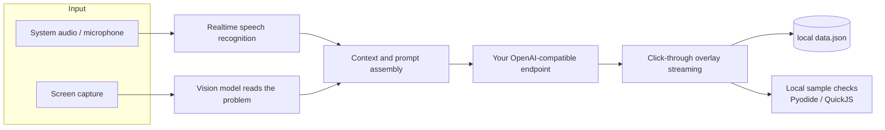

<div align="center">


# MianXu · 面序

**Put the interview back in order.**

You listen, the overlay answers.

A local-first AI copilot for job interviews and coding assessments: it transcribes the interviewer in real time and drafts your answer, or solves a screenshot of the problem on your screen.
Your data stays on your machine. Your models run on your own API key.

[](https://github.com/alvinluo-tech/interview-assistant/releases/latest)
[](https://github.com/alvinluo-tech/interview-assistant/actions/workflows/desktop-check.yml)
[](#platform-support)
[](LICENSE)

[简体中文](README.md) · [**English**](README.en.md)

</div>

---

## Why this exists

An interview moves faster than your thinking. By the time you have heard the question, worked out the shape of the answer and phrased it, the moment is gone. The alternatives are mostly cloud services that want your recording first, or a chat box you have to paste questions into by hand.

MianXu keeps the whole loop on the desktop: **capture → transcribe → answer → render**. The overlay is transparent, always on top and click-through by default, so it stays out of the way. The only thing that leaves your machine is the context you send to the model endpoint you configured yourself.

<!--
Screenshot slots. Remove this comment once the images exist (spec: docs/assets/README.md):
- 1600×1000 PNG, with real names, companies and problems replaced by placeholders
- docs/assets/screenshot-interview.png — interview overlay
- docs/assets/screenshot-exam.png — assessment overlay

<div align="center">
  
  
</div>
-->

## What it does

### Interview

| Capability | Detail |
| --- | --- |
| Live transcription | Captures system audio (WASAPI loopback) or your microphone; each sentence lands as a line without switching windows |
| Answers on its own | As soon as a question is recognized it streams an answer: conclusion first, then the part you actually say out loud |
| Follow-up preemption | When the interviewer changes direction, the in-flight answer yields immediately; the text generated so far is kept |
| Split-sentence merge | A sentence broken by a pause is merged into one question instead of being answered twice |
| Visible thinking | While waiting for the first token: thinking length, quiet time, and a first-token estimate learned from your own machine |
| One-key wrap-up | Ending the session archives everything and returns you to the workbench |

### Coding assessment

| Capability | Detail |
| --- | --- |
| Screenshot to answer | `Ctrl+H` grabs a page (up to 4–6 in a row), `Ctrl+Enter` sends it; the overlay captures your real screen |
| Three modes | Instant / Quick / Programming — conclusion only, conclusion plus reasoning, or algorithm plus edge cases and complexity |
| Local verification | Python (Pyodide) and JavaScript (QuickJS) run the samples from the problem statement on your machine and report pass/fail |
| Fix from samples | When a sample fails, expected vs. actual vs. stderr are fed back for a rewrite — at most 2 rounds, with one-click rollback |
| Interrupt anytime | `Ctrl+.` stops an in-flight answer; whatever was generated is kept and you can re-capture immediately |

### Mock interview

A separate interview room: an AI interviewer draws questions from your résumé and the job description, follows up on your answers, and can read questions aloud with TTS. A debrief report is generated at the end, and sessions survive restarts.

### Also included

- **Question bank** — generate questions from your résumé and the JD; reference answers can be saved into your materials
- **Materials** — résumé, job descriptions, interview notes, saved Q&A, and AI-generated questions
- **Free chat** — text and voice chat, optionally grounded in your materials
- **History** — interview and assessment records with rename, delete and Markdown export
- **9 UI languages** — 简体中文, 繁體中文, English, 日本語, 한국어, Português (Brasil), Español (Latinoamérica), Tiếng Việt, Türkçe
- **19 global hotkey actions** plus a panic key, applied immediately

### Stealth (Windows)

- **Screen-capture exclusion** — the main window and overlay are excluded from recording, sharing and screenshots (`WDA_EXCLUDEFROMCAPTURE`), with a presentation mode that opts back in
- **Process disguise** — launch a renamed copy, rewrite its version resources, strip the icon, swap the window title, and return via `origin.json`
- **Watchdog** — restarts a new instance only after an abnormal exit

> These rely on Win32 APIs and are not available on macOS.

## Hotkeys

Sensible out of the box; switch to either preset or remap everything in Settings → Hotkeys.

| Action | Windows | macOS |
| --- | --- | --- |
| Panic (hide everything) | `Ctrl+Shift+X` | `⌘+Shift+X` |
| Capture / add page | `Ctrl+H` | `⌘+H` |
| Send / answer | `Ctrl+Enter` | `⌘+Enter` |
| Interrupt | `Ctrl+.` | `⌘+.` |
| Scroll back | `Ctrl+↑` | `⌘+↑` |
| Scroll to newest | `Ctrl+↓` | `⌘+↓` |
| Copy answer | `Ctrl+K` | `⌘+K` |

## How it works



Only recognition and generation need the network, and both go to the provider you configured. Transcripts, answers, screenshots and materials stay on disk.

## Install

Grab the latest build from [Releases](https://github.com/alvinluo-tech/interview-assistant/releases/latest):

| Platform | File |
| --- | --- |
| Windows 10/11 x64 | `Mianxu_x.y.z_x64-setup.exe` (installer) or `Mianxu_x.y.z_x64-portable.exe` (portable) |
| macOS 12+ (Apple silicon) | `Mianxu_x.y.z_arm64.dmg` |
| macOS 12+ (Intel) | `Mianxu_x.y.z_x64.dmg` |

The app checks for updates on launch, or use Settings → About → Check for updates. Checksums ship as `SHA256SUMS.txt` on the same page.

> [!NOTE]
> On first launch macOS may block the app via Gatekeeper. Right-click → Open, or allow it once under System Settings → Privacy & Security.

## First run

1. Open Settings → AI services and add an OpenAI-compatible connection (Base URL and API key; you can also pull the model list).
2. Assign models per purpose: **answer** (chat), **vision**, **speech-to-text**, **text-to-speech**. Chat alone is enough to start; vision is required for assessments, speech-to-text for live transcription.
3. Back in Interview or Assessment, pick a résumé and a job description, then press `Ctrl+H` or start the session.

Everything is stored locally; to move machines, copy the data directory.

## Build from source

Requires Node.js 20.19+ (or 22.12+), pnpm 9+, Rust 1.85+, and the usual Tauri prerequisites for your platform (WebView2 / Xcode Command Line Tools).

```bash
pnpm install
pnpm tauri dev      # dev mode, Vite on port 1430 with HMR
pnpm tauri build    # production build with installer
```

Checks:

```bash
pnpm build                       # tsc + vite
node --test tests/*.test.mjs     # unit and integration tests (387 today)
```

Layout:

```
src/main/        main window: workbenches, question bank, materials, history, settings
src/overlay/     overlay: click-through, zones polling, dwell interactions, streaming render
src/mock/        mock-interview window
src/lib/         data layer, BYOK AI adapters, interview and assessment engines, local verification
src-tauri/src/   window and click-through, global hotkeys, WASAPI capture, screen capture, protection
docs/            design notes, ADRs and implementation records
```

## Platform support

| Platform | Status |
| --- | --- |
| Windows 10 2004+ / 11 | Full feature set, including capture exclusion and process disguise |
| macOS 12+ (Apple silicon / Intel) | Interview, assessment and mock interview; no capture exclusion or disguise |

## Data and privacy

- Everything is local: `%APPDATA%\com.luoyaosheng.mianxu\` (settings) and `%LOCALAPPDATA%\com.luoyaosheng.mianxu\data\` (records) on Windows, `~/Library/Application Support/com.luoyaosheng.mianxu/` on macOS.
- No account, no telemetry. Apart from the update check against GitHub Releases, the app does not call out on its own.
- Audio, screenshots and materials are only sent to the model provider you configured — you decide which one and how much.
- Uninstalling does not delete the directories above; remove them manually if you want them gone.

## FAQ

<details>
<summary>Do I have to use the official OpenAI API?</summary>

No. Any provider speaking the OpenAI Chat Completions protocol works: OpenAI, DeepSeek, Qwen, Moonshot, a self-hosted gateway, or a local Ollama. Different purposes can even use different providers.
</details>

<details>
<summary>No audio, or no system sound is picked up</summary>

Check that speech-to-text is configured and selected under Settings → AI services. On Windows the app captures the loopback of the default playback device, so the interview audio must actually play through this machine's speakers or headphones rather than a phone. You can switch to microphone mode if needed.
</details>

<details>
<summary>Which languages can be verified locally?</summary>

Python and JavaScript. Both run in a local sandbox with no network access. Other languages (Java, C++, Go, …) are answered but not executed, and the overlay says "not verified" instead of pretending otherwise.
</details>

<details>
<summary>The overlay does not respond to clicks, or it covers other windows</summary>

That is by design: it is click-through, and buttons respond only after you hover and dwell. Hover a button to operate it, or press the panic key `Ctrl+Shift+X` to hide everything.
</details>

<details>
<summary>Where is my data, and how do I back it up?</summary>

See Data and privacy above. Copy the `data` directory to the same location on the new machine to migrate; settings live in `store.json`.
</details>

## Roadmap

- [x] Realtime interview transcription with streaming answers
- [x] Screenshot-to-answer for coding assessments, multi-page
- [x] Local sample verification (Python / JavaScript) and fix-from-samples
- [x] Mock interviews, question bank, materials, history
- [ ] More local runtimes (Java / C++ / Go)
- [ ] Continue a truncated interview answer
- [ ] Linux support research

## Design notes

Architecture decisions and topic designs live under `docs/`:

- [ADR-0001: orchestrate BYOK tasks locally](docs/adr/0001-local-byok-orchestration.md)
- [ADR-0004: answer continuity defaults](docs/adr/0004-answer-continuity-default.md)
- [BYOK notes](docs/byok.md)

## Contributing

Issues and pull requests are welcome. Please open an issue first for anything larger than a fix, and before submitting:

```bash
pnpm build && node --test tests/*.test.mjs
```

Commits follow [Conventional Commits](https://www.conventionalcommits.org/). UI strings must be updated in all 9 locales — the i18n guard checks that key sets match.

## License

[MIT](LICENSE).

## Intended use

MianXu is a preparation and self-testing tool: mock interviews, debriefs, practice problems and delivery rehearsal are all legitimate uses. Using live assistance during a real interview or exam may violate the rules of the other side and the law where you are; the risk and the consequences are yours.
