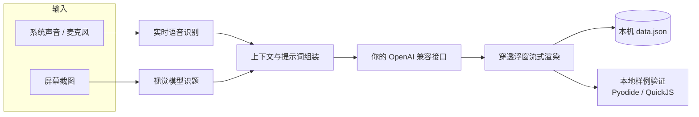

<div align="center">


# MianXu · 面序

**面序，让面试重新有序。**

面试时你只管听，剩下的交给浮窗。

本地优先的 AI 面试与笔试助手：把面试官的话实时转成文字并给出回答，把屏幕上的笔试题直接解出来。
数据留在你自己的电脑里，模型走你自己的 API Key。

[](https://github.com/alvinluo-tech/interview-assistant/releases/latest)
[](https://github.com/alvinluo-tech/interview-assistant/actions/workflows/desktop-check.yml)
[](#平台支持)
[](LICENSE)

[**简体中文**](README.md) · [English](README.en.md)

</div>

---

## 为什么做这个

面试是实时对抗：等你听完、想清楚、组织好语言，节奏已经过去了。市面上能看到的方案大多要先把录音传到别人的服务器，或者只给你一个聊天框，你还得自己把问题打进去。

MianXu 把这条链路放进了桌面端：**采集 → 识别 → 作答 → 渲染** 全程在本地串联，浮窗透明置顶、默认点击穿透，鼠标点不到它，录屏与共享里也不会出现。真正离开这台电脑的，只有你发给所配置模型接口的那部分上下文。

<!--
界面预览位。
截图到位后删掉这整段注释即可显示（规格见 docs/assets/README.md）：
- 1600×1000 PNG，隐藏真实姓名、公司、岗位与题目内容
- 面试浮窗：docs/assets/screenshot-interview.png
- 笔试浮窗：docs/assets/screenshot-exam.png

<div align="center">
  
  
</div>
-->

## 功能

### 面试助手

| 能力 | 说明 |
| --- | --- |
| 实时听译 | 抓系统声音（WASAPI loopback）或麦克风，面试官说一句就落一行字，不需要切窗口 |
| 自动作答 | 识别出问题后立刻流式回答：先给结论，再给可以照着说的展开 |
| 追问抢占 | 面试官话锋一转，正在生成的旧答案立刻让位；已生成的部分保留，不会白花 token |
| 半句合并 | 一句话被停顿切成两段时合并成同一个问题，不会答两遍 |
| 思考可见 | 等首字时显示思考字数、安静时长，以及按本机历史估算的首字耗时 |
| 一键归档 | 结束面试自动落盘，回工作台按时间轴回看问答 |

### 笔试助手

| 能力 | 说明 |
| --- | --- |
| 截屏解题 | `Ctrl+H` 截一页（可连加 4～6 页），`Ctrl+Enter` 发送；浮窗里裁的是真实屏幕 |
| 三档模式 | 秒答 / 快速 / 编程，分别对应「只要结论」「结论+思路」「算法+边界+复杂度」 |
| 本地验证 | Python（Pyodide）与 JavaScript（QuickJS）在本地跑题面样例，直接标出通过 / 未通过 |
| 按样例修正 | 样例没过时把「期望 / 实际 / 报错」喂回模型重写，最多 2 轮，改坏了可以一键回退 |
| 随时打断 | 答题途中 `Ctrl+.` 立刻停下，已生成的内容保留，随时可以重新截图 |

### 模拟面试

独立面试间窗口：AI 面试官按你的简历和岗位动态出题、按你的回答追问或换题，问题可用 TTS 播报；结束后生成复盘报告，支持跨重启续场与历史回看。

### 其它

- **面试题库**：按简历与岗位生成定制题目，参考回答可一键存进资料库
- **资料管理**：简历 / 岗位 / 面试资料 + 预设问答 + AI 出题
- **自由对话**：文字与语音对话，可挂资料查询
- **历史记录**：问答与笔试记录，支持重命名、删除、导出 Markdown
- **9 种界面语言**：简体中文、繁體中文、English、日本語、한국어、Português (Brasil)、Español (Latinoamérica)、Tiếng Việt、Türkçe
- **19 个全局动作热键** + 恐慌键，改动即时生效

### 隐蔽（Windows）

- **反屏幕捕获**：主窗口与浮窗默认排除在录屏、共享与截图之外（`WDA_EXCLUDEFROMCAPTURE`），演示模式可一键放行
- **进程伪装**：改名副本启动、版本资源重写、图标剥离、窗口标题切换，`origin.json` 回跳原始程序
- **守护进程**：仅异常退出时拉起新实例

> 这几项依赖 Win32 接口，macOS 上不提供。

## 快捷键

开箱即用，可在「设置 → 快捷键」改成两套预设之一或自定义。

| 动作 | Windows | macOS |
| --- | --- | --- |
| 恐慌键（隐藏一切） | `Ctrl+Shift+X` | `⌘+Shift+X` |
| 截图 / 加页 | `Ctrl+H` | `⌘+H` |
| 发送 / 作答 | `Ctrl+Enter` | `⌘+Enter` |
| 打断答题 | `Ctrl+.` | `⌘+.` |
| 回看 | `Ctrl+↑` | `⌘+↑` |
| 看新 | `Ctrl+↓` | `⌘+↓` |
| 复制答案 | `Ctrl+K` | `⌘+K` |

## 它是怎么跑起来的



整条链路里只有「识别」和「生成」需要网络，且都发往你自己配置的服务商；转写、答案、截图与资料全部落在本机。

## 下载与安装

到 [Releases](https://github.com/alvinluo-tech/interview-assistant/releases/latest) 取最新版本：

| 平台 | 文件 |
| --- | --- |
| Windows 10/11 x64 | `Mianxu_x.y.z_x64-setup.exe`（安装版）或 `Mianxu_x.y.z_x64-portable.exe`（免安装） |
| macOS 12+（Apple 芯片） | `Mianxu_x.y.z_arm64.dmg` |
| macOS 12+（Intel） | `Mianxu_x.y.z_x64.dmg` |

安装后应用会在启动时检查更新，也可以手动「设置 → 关于 → 检查更新」。校验文件见同页 `SHA256SUMS.txt`。

> [!NOTE]
> macOS 首次打开会被 Gatekeeper 拦下，右键「打开」或在「系统设置 → 隐私与安全性」里允许一次即可。

## 首次配置

1. 打开「设置 → AI 服务」，添加一个 OpenAI 兼容连接（填 Base URL 与 API Key，可一键拉取模型列表）。
2. 按用途分配模型：**作答**（chat）、**识题**（vision）、**听译**（stt）、**语音**（tts）。至少配好作答，笔试需要识题，实时听译需要听译。
3. 回到「面试助手 / 笔试助手」，选简历与岗位，然后按 `Ctrl+H` 或开始面试。

所有配置都保存在本机；换机器时把数据目录复制过去即可。

## 从源码运行

需要 Node.js 20.19+（或 22.12+）、pnpm 9+、Rust 1.85+，以及对应平台的 Tauri 依赖（WebView2 / Xcode Command Line Tools）。

```bash
pnpm install
pnpm tauri dev      # 开发模式，Vite 1430 端口，前端热更新
pnpm tauri build    # 生产构建，产出安装包
```

质量护栏：

```bash
pnpm build                       # tsc + vite 构建
node --test tests/*.test.mjs     # 单元与集成测试（当前 387 项）
```

目录结构：

```
src/main/        主窗口（工作台、题库、资料、历史、设置）
src/overlay/     浮窗（穿透、zones 轮询、悬停驻留、流式渲染）
src/mock/        模拟面试独立窗口
src/lib/         数据层、AI 适配（BYOK）、面试与笔试引擎、本地验证
src-tauri/src/   窗口与穿透、全局热键、WASAPI 采集、截屏、防护与伪装
docs/            设计说明、ADR 与实现记录
```

## 平台支持

| 平台 | 状态 |
| --- | --- |
| Windows 10 2004+ / 11 | 完整功能（含反屏幕捕获与进程伪装） |
| macOS 12+（Apple 芯片 / Intel） | 面试、笔试、模拟面试等主体功能；不提供反捕获与进程伪装 |

## 数据与隐私

- 数据只存本机：Windows 在 `%APPDATA%\com.luoyaosheng.mianxu\`（设置）与 `%LOCALAPPDATA%\com.luoyaosheng.mianxu\data\`（记录），macOS 在 `~/Library/Application Support/com.luoyaosheng.mianxu/`。
- 没有账号体系，没有遥测上报；除更新检查会访问 GitHub Releases 外，应用自身不主动联网。
- 音频、截图与资料只会发给你在设置里配置的模型服务商，用哪个、发多少由你决定。
- 卸载应用不会删除上面的数据目录，需要时请手动清理。

## 常见问题

<details>
<summary>必须用 OpenAI 原生接口吗？</summary>

不需要。任何兼容 OpenAI Chat Completions 协议的服务都能接：OpenAI 原生接口、DeepSeek、通义千问、Moonshot、自建网关、本地 Ollama 都可以，不同用途还可以配不同供应商。
</details>

<details>
<summary>听译没有声音 / 识别不到系统声音</summary>

先确认「设置 → AI 服务」里的听译（stt）已经配好并选中模型；Windows 上抓的是默认播放设备的回环输出，请确认面试声音确实从这台电脑的扬声器或耳机输出，而不是手机外放。需要时可以在设置里切到麦克风模式。
</details>

<details>
<summary>本地验证支持哪些语言？</summary>

Python 与 JavaScript。两者都在本地沙箱里执行，不联网；其它语言（Java、C++、Go 等）只会给出代码，不会跑样例，浮窗上会如实标注「未执行验证」。
</details>

<details>
<summary>浮窗点不动 / 挡住了其他窗口</summary>

浮窗默认点击穿透，只有悬停到按钮上并停留片刻才会响应，这是设计如此。想临时操作它，把鼠标停在按钮上即可；不想要时按恐慌键 `Ctrl+Shift+X` 一键隐藏。
</details>

<details>
<summary>数据放在哪，怎么备份或迁移？</summary>

见上一节「数据与隐私」。把整个 `data` 目录复制到新机器的相同位置即可迁移，设置则在 `store.json` 里。
</details>

## 路线图

- [x] 面试实时听译 + 流式作答
- [x] 笔试截屏解题 + 多页合并
- [x] 本地样例验证（Python / JavaScript）与按样例修正
- [x] 模拟面试、题库、资料与历史
- [ ] 更多语言的本地执行（Java / C++ / Go）
- [ ] 面试回答的「继续生成」
- [ ] Linux 支持调研

## 设计文档

架构决策与专题设计都放在 `docs/` 下，实现与取舍前后一致：

- [ADR-0001 在本地编排 BYOK AI 任务](docs/adr/0001-local-byok-orchestration.md)
- [ADR-0004 回答连续性默认值](docs/adr/0004-answer-continuity-default.md)
- [BYOK 接入说明](docs/byok.md)

## 参与贡献

欢迎 Issue 与 PR。动手前建议先开一个 Issue 对齐方向；提交前请保证：

```bash
pnpm build && node --test tests/*.test.mjs
```

提交信息遵循 [Conventional Commits](https://www.conventionalcommits.org/)，界面文案需同时更新 9 种语言（`pnpm test` 里的 i18n 守卫会检查键集合一致）。

## 许可证

[MIT](LICENSE)。

## 使用边界

MianXu 是面试准备与自测工具：模拟面试、复盘、刷题、练表达都是它的正当用法。把实时辅助用在真实面试或考试里，可能违反对方的规则与当地法律，风险与后果由使用者自负。
