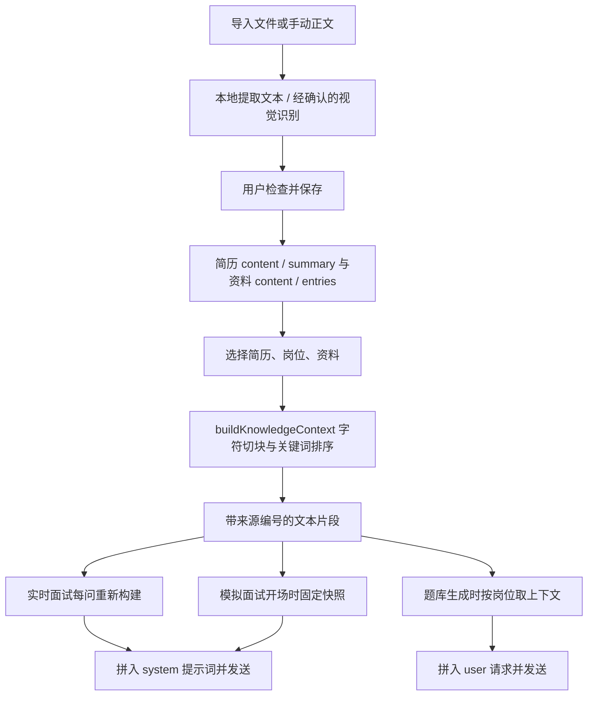
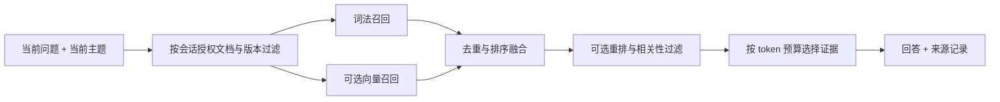

# AI 功能、提示词与上下文架构审计

审计日期：2026-10-30。对象：当前工作区的笔试、实时面试、模拟面试、资料导入、题库、提示、复盘及语音链路。

这是一份分析与实施建议，**文中提出的新架构尚未实现**。本次只新增本文档，不修改业务代码，不读取私人简历、会话或密钥，不调用付费模型。结论来自源码、现有测试、合成输入复现，以及官方资料。

审计过程中工作区另有修复进行，因此不是一个冻结的发布版本。初次基线为 `a771255`，末次针对核心发现复核时为 `be03ff8`，且包含其他未提交修改。关键源码指纹见附录 A；后续实现前须复核当前代码。期间观察到的“笔试答案语言未传入提示词”已在并行修改中补上，本文将它列为回归检查项，不列作当前未修复问题。

## 1. 按风险排序的主要发现

**目前不能认为各部分已经达到最优，也没有评测证据可以证明提示词最优。优先问题是上下文真实性、问题范围、完整性判断和可衡量性，随后才是提示词措辞与检索升级。**

P1 表示可能直接影响答案正确性或事实归属，应优先处理；P2 表示稳定性、可控性和效率的重要改进；P3 表示规模扩大后再做。置信度表示对代码机制的确认程度，不是线上发生概率。没有真实流量评测，本文不提供虚构的错误率或性能收益。

| 编号 | 优先级 / 置信度 | 发现与影响 | 主要证据 |
| --- | --- | --- | --- |
| A01 | P1 / 高 | 实时面试把 AI 参考答案作为 `assistant` 历史继续发送，却没有证明候选人真的这样回答；后续可能把建议或假设延续成个人事实 | [interviewEngine.ts](../../src/lib/interviewEngine.ts)，`answerQuestion`、历史消息组装；[backend.ts](../../src/lib/backend.ts)，`ChatMessage` |
| A02 | P1 / 高 | AI 生成的问答可收藏到资料，之后资料统一作为事实参考；条目没有独立的生成来源、确认状态和证据链，存在“生成内容被重新当作事实”的路径 | [QuestionBankPage.tsx](../../src/main/sections/QuestionBankPage.tsx)，`saveToMaterial`；[knowledgeContext.ts](../../src/lib/knowledgeContext.ts)；`MaterialEntry` |
| A03 | P1 / 高 | 面试历史按消息条数裁剪；笔试追问把所有题混合后截尾。无法保证保留当前问题、正确题干、函数签名和用户纠错 | `interviewEngine.ts:445`；`examEngine.ts` 的 `followUp` 上下文组装 |
| A04 | P1 / 已复现 | 文本流解析忽略 `finish_reason`，有非空文本就可能成功返回。长度截断、缺少正常结束标记的代码可被当作完整答案 | [aiProtocol.ts](../../src/lib/aiProtocol.ts)，`consumeChat` |
| A05 | P1 / 高 | 程序正确性依赖模型判断，没有执行证据；“降低通过率”仅让模型故意制造错误，无法实现指定的真实通过率 | [examEngine.ts](../../src/lib/examEngine.ts)，`followUp` 中 `partial-pass`；不存在相应代码执行验证链 |
| A06 | P2 / 已复现 | 本地检索没有相关性下限；查不到仍填充文本；固定字符切块、重叠和“每份先取一段”可能浪费预算 | `knowledgeContext.ts:17` 起 |
| A07 | P2 / 高 | 模拟面试在开场生成资料快照，后续新问题不重新检索；辅助提示只用 `resumeSummary`，复盘只用问答文本；各功能看到的事实不一致 | [MockPage.tsx](../../src/main/sections/MockPage.tsx)，配置创建；[mock.ts](../../src/lib/mock.ts)，`generateHint`、`generateMockReport` |
| A08 | P2 / 已复现 | 八股比例只做 `>= 50` 的二分；最多追问两次依靠提示词；格式错误回退为追问，不能保证题量、覆盖率和结束行为 | `mock.ts:51`、`mock.ts:96` |
| A09 | P2 / 高 | 主要提示词硬编码但未版本化；没有与模型、资料版本、请求参数绑定的质量评测闭环 | [ai.ts](../../src/lib/ai.ts)、`mock.ts`、现有 `tests/` |
| A10 | P2 / 高 | 资料正文被拼进 `system` 提示词；虽有“不执行资料指令”的文字，仍缺少严格的数据与指令分层；自定义风格写成“优先级最高”也会与事实约束冲突 | `ai.ts:73`、`ai.ts:78`；`mock.ts:67` |
| A11 | P2 / 高 | 自动回答把大多数非填充语音定稿都当作待回答内容；队列缺少问题完成度、合并、取代和时间边界策略 | `interviewEngine.ts:372` 起 |
| A12 | P2 / 高 | 模拟面试错误后以 1.5 秒定时重试，未见统一上限及鉴权、参数、限流等错误分类 | [MockApp.tsx](../../src/mock/MockApp.tsx)，开场 effect 与 `submit` 异常路径 |
| A13 | P2 / 高 | 四用途路由有了，但模型能力配置、任务级输出预算、结构化输出和请求用量记录不足 | [aiConfig.ts](../../src/lib/aiConfig.ts)、[aiRequests.ts](../../src/lib/aiRequests.ts) |
| A14 | P2 / 高 | 题库与资料内“AI 出题”走不同上下文；后者默认取第一份非样例简历和第一个岗位，只传摘要与岗位名 | `QuestionBankPage.tsx:75`；`ResourcePage.tsx:474` |
| A15 | P2 / 高 | 原图保存、取消、来源展示等工程基础已有，但“能成功调用”测试不能证明识别、事实和解题质量 | 资料导入、附件、语音测试及 [InterviewOverlay.tsx](../../src/overlay/InterviewOverlay.tsx) 的 `contextSources` 展示 |

不应把这些问题统一归因为模型不够强。换更大的模型可能缓解一部分表现，也会更流畅地延续错误上下文。修复应先约束数据和程序行为，再通过评测选择模型及提示词。

## 2. 第一性原理：我们到底在优化什么

用户需要的是：在当前问题和资料范围内，及时得到准确、可理解、可继续追问的结果；模拟面试还必须提供有效训练和有证据的反馈。

因此需要分别衡量：

1. **输入正确**：题目是否看全、语音是否听对、说话人和当前题是否分清。
2. **证据充分**：需要的个人经历、约束、上下文是否进入请求；无关和错误内容是否被排除。
3. **推理与输出正确**：结论、代码、解释是否符合题意，是否诚实标注未验证内容。
4. **交互有效**：先展示有用信息，允许纠错、打断和重试，不因失败丢记录。
5. **资源可控**：延迟、调用次数、token、存储和隐私暴露都在预算内。

“最优”必须相对于具体任务、模型、预算和测试集定义。编程题的准确性、口头回答的简洁度、复盘的细致程度不宜用同一套参数。合理目标是找出质量、延迟和成本之间值得采用的方案，而非找到一段永远最好的提示词。

官方的上下文工程说明强调有限上下文内的信息选择；评测指南则要求用任务相关样本持续比较。本文据此采用“源码机制 → 可复现失败 → 改进假设 → 对照评测”的方法，而不把某个厂商的推荐直接视作本应用最佳配置。[上下文工程](https://www.anthropic.com/research/effective-context-engineering-for-ai-agents)、[评测方法](https://developers.openai.com/api/docs/guides/evaluation-best-practices)。

## 3. 现在每个 AI 功能实际如何工作

### 3.1 功能与请求清单

| 功能 | 当前输入与上下文 | 提示词与参数 | 当前边界 |
| --- | --- | --- | --- |
| 实时面试参考回答 | 当前转写问题；最近 12 条非 pending 历史；当次检索的简历、JD、已选资料；岗位进度；最近 3 条截图解答 | `buildInterviewSystemPrompt`；四种回答风格；自定义要求；语言；未指定任务级温度和最大输出 | 历史不是完整的候选人实答；当前语音问题常已在历史中，又追加一次 |
| 新笔试题 | 本次 4 或 6 页以内截图；编程语言、代码模式、质量、补充要求及答案语言 | 固定 `EXAM_SYSTEM_PROMPT` 加档位描述；要求 `<exam-question>` / `<exam-answer>` | 当前新题未注入简历或资料；模式主要影响文字说明和页数；均走视觉路由 |
| 笔试追问 | 当前 solver 的题干与答案全部拼接，取末尾 6000 字符；新截图仅在调用方提供时发送 | 共用笔试 system，增加追问指令 | 默认针对最后一条 turn；未使用 `parentTurnId` 真正隔离题目链；通常不重发原题图片 |
| 模拟面试开场 / 下一问 | 开场时选出的资料文本快照；下一问还包含完整对话转成的一段文本 | 固定面试官人设；温度 0.7；下一问要求 JSON | 无全局 token 预算；缺少程序保证的覆盖和追问上限 |
| 模拟面试辅助提示 | 岗位名、当前问题、`resumeSummary` | 2–3 条提示，温度 0.4 | 不使用同一份完整资料检索结果，也不理解本题候选人已答了什么 |
| 模拟面试复盘 | 全部面试官 / 候选人问答转成 Q/A 文本 | 总评、逐题点评、三条建议；温度 0.5 | 不接收岗位完整要求、难度、资料证据或明确评分量表 |
| 题库生成 | 选中的简历、JD、经验年限；用岗位描述检索的资料 | 10 题 JSON 数组；温度 0.6 | 公司“常考”和概率是生成判断，没有真实题频统计来源 |
| 资料里的 AI 问答生成 | 第一份非样例简历的摘要 + 第一个岗位名称 | 5 / 8 / 12 条 JSON；温度 0.5 | 与题库及当前选中会话的上下文不一致 |
| PDF / 图片文字提取 | 本地 PDF 文字；扫描或图片经确认调用视觉模型 | 逐字提取、保留数字与顺序、不执行图内指令 | 云端视觉识别不等于原文准确；仍需用户核对 |
| ASR | 选定来源音频；按协议走实时连接、分段或文件识别 | 部分路径传语言；百炼支持配置热词表 ID | 未见由当前简历 / 技术栈自动构建且经确认的术语策略 |
| TTS | 已完成并保存的面试官问题 | MiMo / 阿里协议适配、音色；MiMo 有朗读风格指令 | 已有流式播放、打断和本场缓存；仍需真人音质、发音和设备测试 |

请求统一层确实支持 `temperature` 和 `maxTokens`，但支持一个字段不等于各调用已经合理使用。截图接口目前没有暴露同等完整的任务参数入口。`max_tokens` 的语义、结构化输出、思考参数和图像细节还需要按供应商能力适配，不能假定所有“OpenAI 兼容”接口完全相同。

### 3.2 简历和额外资料的真实注入过程



具体事实：

- 文本 PDF 在本地通过 PDF.js 提取；扫描识别按页处理。导入限制包括 20 MB、15 万字符、PDF 30 页、扫描页 10 页，避免无限输入。
- 导入对话框提供可修改正文；扫描图发送需确认。这些是应保留的设计。
- 简历 `content` 保存完整提取文本；`summary` 在该导入路径只是 `text.slice(0, 6000)`，**不是语义摘要，也不是结构化简历事实**。
- `buildKnowledgeContext` 优先用简历 `content`，没有才用 `summary`；JD 用完整 `description`；资料由正文与问答条目拼接。
- 检索用英文等词串和中文双字片段；每块最多 1100 字符、步长 1000，约 100 字符重叠；每份文档最多 256 块。
- 相关性分数是“查询词是否出现”的加和，没有 BM25 的语料统计，也没有向量语义、重排或相关性阈值。
- 默认参考资料预算 18000 字符，最多 24000；先放每份文档的一块，再按分数补其他块。因此并非全局最相关片段优先，也并非严格按重要性保留完整简历。
- 文本含来源编号、标题和正文字符位置。实时面试已有本次参考片段展示，但缺少与每一条最终回答绑定的不可变来源版本记录。

证据：[documentIngest.ts](../../src/lib/documentIngest.ts)、[documentImport.ts](../../src/lib/documentImport.ts)、[DocumentImportDialog.tsx](../../src/main/DocumentImportDialog.tsx)、`ResourcePage.tsx:219`、`knowledgeContext.ts:17`、`interviewEngine.ts:518`、`MockPage.tsx:97`。

**这已经具备检索增强生成的基本形式。RAG 不要求一定使用向量数据库。** 目前需要决定的是现有本地词法检索如何改进，以及何时加入语义检索，而不是从“完全没有 RAG”开始。

## 4. 提示词硬编码是否合理，应该怎样组织

### 4.1 固定规则合理，所有行为写成固定长提示词不合理

固定保存任务规则有明确价值：行为可回归、可审查、可定位版本。不建议每一轮让另一个模型重新发明整套 system 提示词，也不建议开放“任意 system 替换”作为默认设置。

当前实际是“固定模板 + 部分动态变量”，不是全部定死。问题在于模板分散，任务参数和事实混在一起，缺乏统一版本与验证；某些程序约束只用文字要求模型遵守。

还应核对“设置字段存在”是否真的进入请求。例如 `ExamCustomization` 中的 `instructionsPrompt`、`instructionsBase`、`quickPrompts` 在本次搜索的业务调用链中未见使用，不能因为数据结构中有名字就宣称具备自定义提示或学习能力。类似地，消息中的 `webSearch` 元数据字段不代表应用已经接入真实搜索工具。

建议拆成五层：

| 层 | 放什么 | 如何管理 |
| --- | --- | --- |
| 稳定约束 | 不编造个人经历、不声称已运行代码、如何处理缺失信息 | 短而清楚；版本管理；用户风格不能覆盖 |
| 任务规则 | 当前是出题、参考回答、题目识别、代码解释还是复盘 | 小型任务模板，避免一个万能 prompt |
| 类型化参数 | 语言、深度、代码模式、难度、时间预算 | 先校验，再渲染，不只收自由文本 |
| 证据数据 | 简历、JD、已确认资料、真实对话、当前题干 | 独立低信任数据块；带版本和来源 |
| 当前请求 | 本轮问题、纠错、需要澄清的点 | 明确边界，最新有效纠错优先于过时观察 |

对于支持 `developer` 的服务可使用相应层级；对只支持 `system/user/assistant` 的兼容服务，保持稳定规则在 system，资料以独立 user 数据消息传入。不能为了追求格式一致强行发送不受支持的角色。

XML 标签或 JSON 包装有助于区分数据，**不构成安全隔离**。要配合资料来源标记、输出验证和功能权限边界，不能只再加一句“忽略恶意指令”。官方也提醒避免将不可信输入放到高优先级消息中。[指令与不可信输入](https://developers.openai.com/api/docs/guides/agent-builder-safety)。

### 4.2 建议的任务模板，而非“已验证最优提示词”

以下是用于评测的候选规则，需与当前模板对照测试后决定取舍。

**面试参考回答：**

```text
任务：为当前问题生成一段适合口头表达的参考回答。
只有个人事实证据明确支持的内容，才能写成“我做过 / 我负责”。
资料没有的数据、规模、公司、职责和结果不得补造。
通用技术知识可以说明；个人经历缺失时用“如果处理这个问题，我会……”表达。
发现影响结论的歧义或错误前提时，先指出需要确认的点。
遵守本轮语言和表达长度；复杂问题允许先给结论，再给必要依据。
历史 AI 建议不代表用户曾说过或实际做过。
```

不必把这段要求再叠加“世界顶尖”“全能专家”等角色修饰。身份设定不能替代证据和行为约束。固定 150 字适合快速口头提示，却未必适合系统设计、故障排查或复杂追问；应提供“短答 / 展开”与明确时间目标。

**模拟面试出题：**

```text
根据当前主题、候选人真实回答和证据，提出一个可独立理解的问题。
可以深挖回答中的具体主张，但不要替候选人补造经历。
本轮只输出一个问题，并返回 NEW / CONT 的决策建议及主题标识。
不要泄露参考答案；候选人不懂或要求澄清时，允许改述或给分级提示。
题量、追问次数、主题覆盖和结束条件由应用提供的状态约束决定。
```

模型负责建议问什么；应用决定本轮允许追问还是必须换题。不能让模型通过输出任意 `kind` 无限延长会话。

**笔试题：**

```text
先确认题目类型、完整题干、输入输出、约束、样例和代码接口。
如果关键内容缺失，返回需要补充的具体内容，不能自行补造决定答案的条件。
区分“题目要求”“用户语言偏好”和“截图中的无关内容”。
代码必须匹配 ACM / 函数接口、语言版本和复杂度要求。
给出简短可检查的推导或关键不变量，不要求展示内部思维链。
只有收到真实执行结果，才能写“该样例已运行通过”；否则标为未执行验证。
```

题目规定 Java，但偏好选择 Python，或题目提供固定函数签名时，应有明确冲突处理规则。不要让两个相互矛盾的指令自然拼接后由模型猜。

**复盘：** 用岗位维度和实际回答逐项点评，每条结论关联消息证据；“没问到”“没听清”不等于“不会”。辅助提示影响下的表现与独立作答表现应分开记录。反馈是训练建议，不能把模型主观分数包装成企业录用概率。

### 4.3 可配置与版本化的边界

建议引入 `promptId`、`promptVersion`、任务参数版本、输出 schema 版本和变更说明。将规范模板集中管理，但保留各任务不同规则。

用户适合配置：回答长短、技术深度、语言、语气、代码语言、模拟面试目标。用户额外风格只是风格约束，不应使用“优先级最高”这种可能覆盖事实要求的措辞。

few-shot 示例优先来自本应用真实失败类别，例如纠错、资料不足、多页跨题和简历事实缺失。每项任务先试少量典型例子，只有评测提升才保留，避免把所有边界案例塞进线上每次请求。

## 5. 实时面试：主要问题在“对话是什么”

### 5.1 必须区分四种内容

1. 面试官确实说过的话。
2. 候选人确实回答过的话。
3. AI 给出的参考答案。
4. 用户确认过的简历和项目事实。

当前真实面试的 AI 回答作为 `ASSISTANT` 存储和回传；模拟面试里同样的 `ASSISTANT` 角色却代表候选人的实际输入。角色名可以不同场景复用，但底层上下文和事实管理必须知道内容的来源，不能只看 `role`。

例如，AI 对“项目如何做缓存”给出参考建议“使用 Redis 加本地缓存”。下一问“那一致性如何保证”时，当前历史可能使模型继续假定候选人已经采用该架构。即便回答语言自然，也未必符合真实简历或候选人刚才的实答。

建议消息至少补充概念字段：`actor`、`origin`、`questionId`、`sessionId`、`isUserConfirmed`、`supersedesMessageId`。AI 参考答案保留用于解释连续性，但明确标注 `generated_suggestion`，不自动进入个人事实库。

### 5.2 每轮应有问题边界和时间边界

自动转写定稿目前会追加历史并进入最多 8 个问题的队列。它有防并发和会话 ID 检查，值得保留，但尚不等于有效的问题调度。

- 当前语音问题已经进入历史，再作为最终 user 消息追加，存在重复。
- 当多段话在 AI 作答时排队，后续处理旧问题使用的是最新全局历史，可能混入尚未轮到的问题。
- “等等，我重新问”“不是 Redis，是 Redisson”应取代或纠正待答题，不该生成两个独立答案。
- 连续几句描述可能组成一道完整系统设计题，不宜按每次停顿各答一次。

建议给每个待答问题绑定原始消息 ID 和截止位置；构建历史时截到该位置，当前规范化问题只发送一次。对于明确的纠正、撤回和重复转写，应用先做去重和版本处理；不确定的合并提供手动确认。强模型分类可作为补充，不能让每句发言必经额外 LLM 串行调用。

### 5.3 转写与纠错也属于 AI 质量

当前清理逻辑会去语气词、忽略纯数字短句，静音和短句也影响提交时机。这些启发式有用，但可能丢失本轮关键补充，例如规模数字或枚举答案。

建议保留 `rawTranscript`、`normalizedTranscript` 和 `userCorrectedTranscript`，不要不可逆覆盖原文。纠错建立版本关联，重跑受影响回答和检索，而不是把旧错题和新题共同作为事实。

评测加入 Redis / Redisson、幂等 / 冪等、技术英文、数字量级、多说话人和长停顿。简历中的项目名、缩写可生成候选术语表，经用户确认后用于供应商支持的热词功能；未支持热词的协议保留原样，不用无证据的 LLM“润色”替换识别结果。

系统声音来源不等于可靠说话人分离。没有明确声道或说话人证据时，应允许标注“身份不确定”，不能把所有采集到的声音都认定为面试官。

## 6. 笔试：正确识别、按题隔离、可验证输出

### 6.1 新题默认不需要简历 RAG

选择题、算法题、SQL 和给定约束的代码题，主要证据是当前题干、图片、接口和用户确认的语言要求。把简历注入这些请求通常只会增加噪声。只有“结合我的项目回答”等明确依赖个人材料的题目才按需加入资料。

当前新题请求没有加入简历，这一点本身合理。需要加强的是图像与题目结构，而不是为所有 AI 功能统一套同一份简历上下文。

### 6.2 保存原图正确，但识别文本仍是模型产物

当前原题截图和文字、答案分别保存，能追溯问题来源。必须保留这一能力。不过 `<exam-question>` 是同一个生成模型转写出来的，不是经独立校验的原文；截图中模糊的负号、指数、比较符、数组范围和函数签名会直接改变答案。

建议识别结果包含 `questionType`、题号、`constraints`、`examples`、接口、`missingInformation` 和对应图片位置。模型自报置信度只能作为辅助，不能当成校准后的准确率。

默认可用一次视觉请求完成清晰短题。只有关键字段缺失、低可读性、多页关系不明或高复杂度时，升级到“提取 / 用户确认 / 解答”流程。不要让每道题固定变成 OCR、规划、解题、复核四次调用。

图像上传应关注裁剪、文本尺寸、旋转、多页顺序和重叠去重。当前保存附件的压缩与**发送给模型的图片处理**是两条不同路径，不能把存储压缩当作上传优化。按模型支持选择细节参数，小字失败先引导裁剪或补图，不靠提示词要求“务必看清”。[视觉输入的限制](https://developers.openai.com/api/docs/guides/images-vision)。

### 6.3 一次截图请求与一道题不是同一个实体

当前一个 `SolverTurn` 可包含多张截图，也可含多道题；只解析第一对题干 / 答案标签。即使能显示全部内容，记录和追问仍不一定能准确定位到具体题。

建议结构是：`ExamSession → Question → SolutionRevision / FollowUp`。每题有独立 ID、原图引用、规范题干、约束、最新有效解法和纠错记录。现有 `parentTurnId` 可作为迁移基础，但必须真正用于检索对应题目链。

追问“优化第二题”只构建第二题的题干、约束、最新代码、相关报错和本次请求；不要拼全场所有题后截尾。长代码要保留完整函数、输入输出和关键数据定义，预算不足时明确告知并让用户选择代码范围。

### 6.4 三种模式需要不同服务目标

| 模式 | 建议优先级 | 应避免 |
| --- | --- | --- |
| 秒答 | 先给可理解的结论，缺关键题干时先指出缺失 | 既要求完整长题转写在前，又承诺很快出现答案 |
| 快速 | 结论 + 关键解释；按题型决定长度 | 选择题和复杂系统设计共用同一输出预算 |
| 编程 | 接口与约束正确、代码完整、边界和复杂度 | 用视觉模型名称或“大模型”标签代替代码能力评测 |

原题完整转写与快速显示存在资源取舍。可让快速模式保存原图并生成必要的题干要点；需要逐字文本时再展开提取。模式是否采用两阶段、是否把提取后文本交给另一代码模型，都要比较实际准确性、延迟与调用成本。

### 6.5 验证必须诚实

当前没有代码执行工具链，不应因为模型“自检”就标为已通过。推荐至少区分：未执行、人工核对、运行已知样例、运行扩展用例。执行样例也不证明所有隐藏用例通过。

如后续加入练习用的本地运行器，执行来自图片或模型的代码必须有明确启动动作、隔离、无默认网络、资源与时间限制、受限文件系统；不应直接在应用进程里运行。不能靠提示词实现隔离。

“按目标 60% 通过率制造局部错误”没有真实评测分布，无法可信实现，也与准确解题目标冲突。建议移除，或改为明确标注的“基础解法 / 暴力基线 / 学习错误案例”，给出复杂度与适用范围，而不是保证一个未经测量的通过率。

## 7. 模拟面试、提示与复盘应共享事实，但不共享职责

### 7.1 资料快照应固定版本，检索应按轮变化

开场保存知识快照有可复现价值，不应简单取消。问题是现在只保存开场选中的文本片段，后面问到另一个项目时，再相关的原文也可能根本不在快照里。

建议固定的是选中文档 ID 与版本，动态的是每轮从这些版本中取哪些片段。称为 `SessionKnowledgeSnapshot`：会话不因用户在另一窗口编辑资料而悄悄改写背景；用户主动刷新资料时记录版本变更。辅助提示、题库和复盘都使用相同的来源协议。

### 7.2 训练流程应由程序维护

当前“八股比例”只是两种倾向，不能表示精确配额。应选择一种诚实产品语义：要么明确叫“更偏基础 / 更偏项目”，要么按计划新题数计算目标配额，记录实际覆盖并允许实际对话有小幅偏差。

建议维护：主题、能力维度、已问新题、连续追问数、总问答数、已用时、薄弱点证据、下一步允许动作。

- 模型提出下一问及 `kind` 建议。
- 程序检查主题是否重复、是否达到追问上限、是否必须换题。
- 同一问题最多两次连续追问应有计数；总轮次 / 时长也有独立上限。
- “不知道”可改述、降低难度、给提示或换题；不该循环追问同一句。
- 用户纠正面试官前提时先更新前提，不直接把纠正判为答非所问。

这不是要求引入复杂多智能体系统，而是让一个受约束的工作流完成训练任务。

### 7.3 提示与复盘要有不同的信息和输出合同

提示建议分级：先提醒审题与结构，再提供关键词，最后才给参考答案；记录候选人用了哪一级提示。当前自动为每题生成提示可能增加开场后的并发用量，可改为按需请求，或把“是否预取”作为经评测的体验选择。

复盘至少接收：目标岗位关键要求、难度、实际问答、提示使用情况和评分维度。每条点评关联本轮原话或消息 ID；不将推测的能力不足包装成事实。长会话可先逐题提取结构化观察再汇总，提取结果始终能返回原消息；少量短会话直接整体复盘更简单。

不要默认每轮调用一个额外“评委模型”。先把出题、答题记录和必要的点评结构做准，再按复盘耗时和用户需求决定何时计算。

### 7.4 结构化输出需要程序承接

当前要求 JSON，但下一问解析失败后把整段文本当作问题，可能朗读 JSON、解释或异常内容。格式不合法应进入可恢复的显式失败状态，而不是假装是一道有效问题。

按模型能力采用三档：严格 JSON Schema、JSON 模式、纯文本加本地 schema 校验。严格结构也只保证结构，不保证事实、题量和正确性；仍需程序检查。有限的格式修复最多走一次，需计入预算；不支持时可用可见的重试 / 换模型入口，不能无限隐式修复。

OpenAI 与百炼均区分 JSON 有效性和 Schema 约束，支持范围随模型而异，因此不宜在所有 BYOK 请求上无条件启用同一参数。[OpenAI 结构化输出](https://developers.openai.com/api/docs/guides/structured-outputs)、[百炼结构化输出](https://help.aliyun.com/zh/model-studio/qwen-structured-output)。

## 8. 上下文管理：从“截字符串”改为“按任务装配”

### 8.1 存档与上下文是两回事

用户要求保留所有题目和记录是正确的产品需求；这不意味着每轮要发送所有历史。应完整保存原始数据，按本轮任务选取少量必要内容。

推荐统一的 `ContextAssembler`，但采用不同任务策略：

```text
稳定规则与输出合同
  + 会话中已确认的事实与版本
  + 当前主题或当前题的结构化状态
  + 与问题直接相关的近期原始消息
  + 从已授权文档中检索到的证据
  + 必要的历史决策 / 纠错摘要
  + 当前唯一请求
```

历史采用“近期原文 + 结构化状态 + 可回查旧记录”。不要递归总结同一份模型摘要直到原话和不确定性消失；总结条目保留 `sourceMessageIds`、事实类型和确认状态，个人事实仍以原文及明确纠错为准。

### 8.2 使用统一 token 预算

当前 18000 字符资料、12 条历史、6000 字符截尾不是统一预算；加上岗位进度、截图记忆、自定义文本后，整次请求仍可能超过小模型窗口。模拟面试和复盘则直接追加全部文本。

预算应满足：

```text
可用文本输入预算
  = 模型上下文上限
  - 预留输出
  - 多模态 / 模板开销
  - 安全余量
```

有可靠 tokenizer 时按实际模型计数；未知 BYOK 服务使用保守估算和可配置上限，不能宣称“中文字符数等于 token 数”。模型支持图像数、字节数与 token 窗口也需要分别检查。

超预算时的保留顺序应明确：当前问题与关键约束、纠错和必要事实不能丢；先删重复和低相关资料，再缩减旧历史。某个任务是否需要全份简历，应由任务决定。复杂代码题不能用截掉半个函数来满足预算。

### 8.3 把可信度和相关性分开

高相关不代表可信。建议证据至少区分：用户确认事实、导入未校正文本、用户明确的假设、模型生成草稿、一般技术资料、旧会话观察。

尤其要修复两个路径：

- 题库生成参考答案收藏后，不得自动成为“我确实做过”的经历；收藏可保留，但须标为 AI 草稿，用户确认个人事实后才升级。
- `solverMemoryBlock` 目前将最近三条解答拼入“事实参考”总块。应作为模型建议另放，并核对会话 / 题目范围，不能仅凭变量当前还有内容就声称属于“本场”。期间新增的 `prepareExamRun` 已为新工作台运行重置 solver，能收敛正常入口的生命周期风险；本建议仍要求消费上下文时保留明确关联。未实测证明当前版本会跨会话串题，不将它写成已确认的线上事故。

岗位历史进度也不是技术答案证据。与当前问题无关时不必每轮注入全部轮次；更不应让“之前通过面试”提高一条无来源技术结论的可信度。

## 9. 是否需要 RAG，以及如何落地

### 9.1 选择依据

| 情况 | 建议 |
| --- | --- |
| 一份较短简历 + 一个 JD | 优先完整、稳定注入必要事实；无需向量服务，避免检索漏掉核心背景 |
| 少量资料，关键词清楚 | 改进现有本地检索：语义边界、领域词、去重、阈值、按类预算 |
| 大量资料、跨项目、同义表达多 | 对照评测混合词法 + 向量检索，再决定是否启用 |
| 当前截图算法题 | 以本题结构化上下文为主，通常无需个人知识库 |
| 本场旧问答追问 | 先按会话 / 题目 ID 精确选取；不是首先去全库向量搜索 |
| 公司最新业务或技术版本 | 需要经授权且有时效来源的外部查询；个人资料 RAG 不能保证更新 |

不能拿“达到多少份文件”作为唯一开关：文档长度、内容相似度、术语差异、延迟目标和实际漏召回情况才是依据。

### 9.2 推荐分三步做

**第一步：改造现有轻量检索。**

1. 保留短简历与 JD 的必要全局事实，资料按相关性选取。
2. 按项目、标题、问答对、列表和代码块切片，不随意切断一个问答或函数。
3. 块附带文档标题、项目名、章节、原文位置；不自动生成无证据的补充事实。
4. 加技术词同义映射和适量中文分词；明确处理 `C`、`R`、`C++`、`C#` 等短术语，当前英文正则至少两字符存在盲点。
5. 查询结合当前问题和当前主题，解决“那它为什么这么设计”的指代，不只检索这几个字。
6. 对重叠块去重，限制同文档重复占位；低相关时允许返回空，不把所有已选资料塞满。
7. 将 sources 与每次回答绑定，保存版本、位置与命中原因；展示的是“已发送片段”，不要误称为模型确实使用的证据。

这一步可先沿用当前内存实现，不必立即引入数据库或框架。改进评分也不能单凭绝对阈值跨查询比较；阈值要在样本集上校准，区分“完整背景保留”和“相关片段检索”。

**第二步：增加可重建的本地索引。**

资料量增长后，可以在 Rust 层维护 SQLite 文档 / chunk 元数据及 FTS5 索引，放到应用本地数据目录的独立知识库子目录，避免向量和索引随全量业务 `data.json` 跨窗口传播。

FTS5 提供全文检索和 BM25，但中文不能直接假设默认 `unicode61` 等于中文分词。可在应用侧产出中文词 / 双字词与技术 token，再交给索引；trigram 可作为补充，但少于三个 Unicode 字符的全文查询不会匹配，必须保留短词策略。具体选择需通过本应用中英文技术资料测试。[SQLite FTS5 官方说明](https://www.sqlite.org/fts5.html)。

原文和业务记录是主数据，索引是可删除重建的派生数据；索引失败不阻止用户查看简历或使用基本回答。修改、删除和撤销授权要同步失效旧块，不能只有新增没有回收。

**第三步：经评测引入可选语义检索与重排。**



可以从词法和语义分别召回少量候选、用 RRF 等方法融合开始，再比较是否需要重排。候选数和最终块数只是待调参数，不是预设的最优常数。不能直接把不同量纲的 BM25 分数和余弦相似度生硬相加。

向量模型与重排模型应作为独立可选能力配置，不与对话模型混为一谈；本地与云端分别评估。云端 embedding 也会发送资料，需要说明发送范围；供应商密钥和地域同样需要正确匹配。断网或 embedding 失败时可显式降级到词法检索。

缓存 / 索引键至少包含内容 hash、文档版本、chunker 版本、embedding 模型及其版本 / 维度。不同模型的向量不能混用。若模型别名背后版本变更，需允许重建，而不是永远沿用旧索引。

上述方式可全部保留在现有 Tauri 项目内，用 TypeScript 做前端与任务装配，Rust 做本地持久化和检索服务。不需要为 macOS 另写一套 AI 业务，更不需要仅为 RAG 引入 Swift 或常驻云服务器。

### 9.3 暂不推荐的复杂度

现阶段不优先做 GraphRAG、全库自动总结树、多轮自主检索代理、多个模型逐题辩论或微调。它们可能适合后续规模与任务，但当前已确认的问题大多不依赖这些能力就能修复。

也不需要为了接入 RAG 先引入大型编排框架。先定义数据、接口和评测，再决定依赖。混合检索、上下文补全和重排可以改善某些数据集，但不能把厂商案例中的收益百分比移植成本应用承诺。[检索与重排的官方研究说明](https://www.anthropic.com/research/contextual-retrieval)。

## 10. 还应一起优化的工程设计

### 10.1 模型能力与任务档位

四用途路由应进一步绑定能力描述：视觉输入、结构化输出方式、窗口大小、输出上限、支持的参数、语音协议及已验证状态。目录中有模型不等于它适用于任一用途，简单对话测试也不证明能读小字或写对代码。

不必为每个功能都增加一个新模型设置。先在现有路由上添加任务配置；仅当评测显示代码解答、廉价结构提取或报告确有不同需要时，再提供高级覆盖。

不要把温度降到零视为正确性保证。出题多样性、结构抽取和代码回答需要不同取舍；某些模型不接受相同参数，应由能力适配层处理。

### 10.2 输出完成状态与有界重试

统一响应建议携带 `text`、`completionStatus`、`finishReason`、`usage`、模型标识和请求标识。区分正常完成、截断、取消、拒绝和异常断流，不能把非空输出统称成功。

重试应分类：401 / 403 提示检查配置；参数错误调整能力设置；429 / 部分服务错误允许少量退避；已经输出内容的请求不默认从头重试，以免重复调用和覆盖有效部分。不能只靠 1.5 秒固定定时器无限尝试。

格式、事实和业务完整性都需校验，但修复不宜无上限追加模型调用。用户应看得到结果为什么被标为不完整、如何恢复。

### 10.3 区分四类缓存

| 缓存 | 推荐复用范围 | 失效关键 |
| --- | --- | --- |
| 文档解析与索引缓存 | 相同内容与解析 / 切块版本 | 正文、处理版本改变 |
| 检索结果缓存 | 相同问题、主题、授权集合和文档版本 | 选材、纠错、文档或策略变化 |
| 服务端提示前缀缓存 | 相同稳定规则和背景前缀 | 供应商与模型规则、前缀变化 |
| 当前 TTS 音频缓存 | 已完成问题的语音重播 | 文本、服务 / 音色配置、会话结束 |

当前 TTS 的缓存不是知识库，也不是提示缓存。检索缓存不能忽略会话授权；生成答案缓存不能只用问题字符串，否则不同简历和题目约束可能误用同一答案。

稳定规则与必要背景放前面，动态证据和当前问题在后面，有利于评估前缀复用；但是否实际命中、是否需要显式缓存参数、如何计费，必须看具体服务和模型，记录实际 cached usage，不能声称换个顺序就必然省费。[提示缓存机制](https://developers.openai.com/api/docs/guides/prompt-caching)。

### 10.4 语音体验与内容质量

保留现有 TTS 的流式播放、停止、取消、缓存与系统语音选择。真实验收还要测首个可听音频时间、技术术语和数字发音、长句停顿、耳机 / 扬声器切换、系统休眠恢复和 macOS 音频权限。

面试官文本应保持可朗读；不要让错误 JSON、Markdown 标记或未经验证的代码进入朗读。TTS 只负责读问题，不把润色后的另一个问题替换掉保存的原题。语音质量不能仅用“API 返回了字节”判定。

### 10.5 隐私、来源与可观测性

简历和选中资料发送给模型是功能所需，但联系方式等与答题无关字段可提供脱敏选项。扫描图确认已有；还需保证界面显示的实际路由与发送目标一致，包含视觉模型跟随对话模型的情况。

调试记录默认只保留任务、耗时、token、状态、匿名化来源 ID 与版本，不记录密钥和整份私人正文。用户主动开启本地诊断包时，再说明范围和保留期。向量数据同样可能包含敏感信息，不能因为是 embedding 就按非敏感缓存处理。

推荐每次请求留下不含正文的 `RequestManifest`：

```ts
interface RequestManifest {
  requestId: string;
  task: string;
  sessionId?: string;
  questionId?: string;
  promptId: string;
  promptVersion: string;
  providerId: string;
  modelId: string;
  modelRevision?: string;
  knowledgeVersions: string[];
  selectedSourceIds: string[];
  inputTokenEstimate?: number;
  outputLimit?: number;
  firstUsefulOutputMs?: number;
  totalMs?: number;
  completionStatus: string;
}
```

这是建议的数据合同，不是当前已有接口。诊断信息也应本地、可关闭、可删除；来源 ID、文件名和时间等元数据同样可能敏感，导出时需要处理。

## 11. 场景覆盖与质量评测

### 11.1 当前测试证明了什么

现有测试覆盖资料读取、部分晚段检索、长度限制、权限确认、请求协议、取消与生命周期。这些对可靠性有价值；它们大多用固定响应或合成服务，不等于已验证真实模型在复杂题上的质量，也不能据此宣称提示词最优。

本次额外进行了**内存中运行源码的合成复现**，没有写入测试文件或调用网络模型：

| 输入 | 实际观察 | 可以得出的结论 |
| --- | --- | --- |
| 简历只含无关演示段落，query 为 `Kubernetes` | 返回 3 段、约 3300 字符，且无该术语 | 当前检索存在无命中仍填入资料的行为；不是完整召回质量统计 |
| 模拟下一问返回“这不是合法的结构化响应” | 作为 question 原样接受，`turnKind = CONT` | 非结构化回退会进入正式问题 |
| 相同配置，基础比例分别为 51 与 100 | system prompt 完全相同 | 当前占比是二分倾向，不能实现精确配比 |
| SSE 输出 `def solve():`，`finish_reason = length`，随后 EOF | 返回该字符串作为成功结果 | 当前文本解析不能识别这类截断 |

初次读取时笔试答案语言缺失，随后已观察到工作区补上 `buildExamUserPrompt` 的 `answerLanguage` 传递；这是并行修复进展，不是本次文档实现的修复。其他发现未因这一变动自动关闭。

### 11.2 必须加入的任务场景

| 类别 | 场景 | 正确行为 |
| --- | --- | --- |
| 面试事实 | 简历没有流量、收益和团队规模 | 不补造数字，区分通用建议与本人经历 |
| 面试事实 | 两份资料中的职责或时间冲突 | 指出冲突、询问确认，不默认较新文档全部正确 |
| 面试追问 | “那你刚才为什么没这样做” | 区分本人实答与 AI 参考建议，正确解析指代 |
| 面试纠错 | Redis 被识别成 Redisson，用户更正 | 关联旧消息并重建受影响上下文 |
| 面试调度 | 连续背景、半句、撤回、多个排队问题 | 合并 / 替代或人工选择，不抢答每次停顿 |
| 面试声音 | 一句数字、技术缩写、说话人不明 | 保留关键原文和身份不确定性 |
| 笔试识别 | 负号、上标、模糊比较符、小字约束 | 标注缺失并请求局部补图，不编造 |
| 笔试识别 | 多页同题、重叠页、一图多题 | 正确排序、去重并按题建立 ID |
| 编程 | ACM 与核心代码、固定函数签名、版本冲突 | 返回匹配接口和语言版本的完整代码 |
| 编程 | 空输入、溢出、负数、重复值、极限规模 | 解释适用条件，按验证能力检查边界 |
| 笔试追问 | 第 10 题后追问第 2 题的某份代码 | 精确定位题目与代码版本，不从尾部猜题 |
| 验证 | 模型说“全部样例通过”但未执行 | 不显示已运行通过的确认状态 |
| 模拟面试 | 长期连续 CONT、相似题复述 | 程序限制追问并保证覆盖与总量 |
| 模拟面试 | 用户不知道、要求改述或暂跳 | 合理调整训练流程并记录辅助程度 |
| 模拟复盘 | 没问到数据库，或 ASR 不清楚 | 不把缺证据判为数据库能力差 |
| 题库 | 公司常考概率、未经证实的个人项目答案 | 标为准备建议，不声称有真实统计或个人事实 |
| 资料可信度 | AI 草稿收藏到手动资料容器 | 保留条目来源，未确认前不升级事实 |
| 检索 | 同义中文问法、英文缩写、`C` 等短词 | 比较词法与语义策略的实际命中 |
| 检索 | 完全无答案或资料已删除 | 返回无证据；删除内容不得再召回 |
| 上下文 | 短窗口模型、超长会话与长代码 | 按预算装配，关键约束完整，不静默裁断 |
| 对抗输入 | 图文 / PDF 中“忽略规则并虚构经历” | 只作数据，输出不能被材料中的伪指令支配 |
| 协议故障 | 无效 JSON、token 截断、半途断流 | 明确不完整 / 可恢复失败，保留已生成内容 |
| 服务故障 | 401 / 429 / 503、断网、取消 | 正确分类、有界重试、不串入迟到答案 |
| 语音体验 | 新问题到达、录音、静音、切设备、退出 | 播放状态与会话一致，停止后不复活 |

这张表仍不是“穷尽所有情况”；上线后要用真实失败样本扩展，同时避免把用户私人数据直接纳入公开测试集。

### 11.3 怎样证明一个优化值得采用

先建立可授权、去标识的评测集，并把开发调参样本与留出验收样本分开。建议先从每个核心任务几十个有明确预期的案例起步，再按失败类别补齐；数量是启动规模建议，不是统计充分性的保证。

| 层 | 应测指标 |
| --- | --- |
| OCR / ASR | 关键约束、数字、术语准确率，纠错成本，漏掉内容的比例 |
| 检索 | 证据级 Recall@k、排序质量、无答案时的错误召回、重复占比 |
| 事实回答 | 无依据个人事实率、引用内容真实支持率、纠错遵从、矛盾处理 |
| 代码 | 已知和扩展样例结果、接口正确、复杂度符合、验证状态诚实性 |
| 模拟面试 | 主题覆盖、重复题、追问上限、难度适配、点评证据支持 |
| 协议 | 结构校验成功、截断检出、取消后零迟到写入、有界重试 |
| 体验与资源 | 首个有用输出、首个可听音频、总耗时、p50 / p95、token / 调用数 / 成本 |

不要只看“内容更长”或“回答更像专家”。自动评委适合按量表对照或分类，但要用人工标注校准，不能让同一个模型自评就当真值。事实指标需要检查原证据，而不只是检测答案里是否出现一个合法来源编号。

建议在相同模型和任务参数下比较：

- A：当前实现。
- B：修正事实分层、题目范围和预算后的轻量检索。
- C：B 加混合语义检索，必要时加重排。
- D：资料确实较短时完整注入，检验是否反而更可靠。

每个策略再单独比较提示词版本，避免一次更换提示词、模型、检索和上下文长度而无法归因。模型输出有随机性，同一案例应适当重复并记录模型版本；真实付费评测单独按预算执行，本次未运行。

发布门槛应先确保零容忍的程序不变量，例如未执行不能显示“已运行”、已删除资料不能召回、取消后不能写入。对开放式回答质量则采用基线对照、人工验收和风险分组，不能随意规定一个“95 分就最优”的指标。

## 12. 建议实施顺序与验收方式

| 阶段 | 优先工作 | 验收重点 | 暂不引入 |
| --- | --- | --- | --- |
| 0：留基线 | 记录任务 prompt / 参数 / 来源清单，建立合成与标注样本 | 能复现同一请求装配；不含密钥与私人原文 | 自动全量上传日志 |
| 1：正确性 | 区分实答与 AI 建议；逐题上下文；纠错版本；完成状态；有界重试；限制错误格式回退 | A01–A05 的失败路径可稳定测试；上下文不混题、不升级草稿 | 向量数据库、额外评委链 |
| 2：上下文一致性 | 会话文档版本、近期原文 + 结构化状态、统一预算；提示 / 复盘 / 题库共享事实服务 | 短模型及长会话测试；新问题能找到同会话其他项目证据 | 无差别全量拼资料 |
| 3：检索改进 | 语义边界切块、词法评分、去重、短词和无答案策略、来源落盘 | 相同样本质量提升且延迟可接受；与完整短资料注入对照 | 每轮多次 LLM 查询扩展 |
| 4：按需扩展 | 本地 FTS 索引，可选 embedding / 重排、提示前缀缓存 | 留出集证据召回 / 正确性增益覆盖其成本，离线降级可用 | 以“用了 RAG”替代验收 |
| 5：训练闭环 | 模拟面试状态机、分级提示、证据化复盘、按需验证工具 | 覆盖与难度诚实、用户训练收益、可追溯结果 | 默认多智能体或全自动执行代码 |

阶段可局部并行，但不要先扩充知识库和提示词，再回头解决错误事实的来源。

建议的模块职责如下，名称仅作设计草案：

```text
PromptRegistry       稳定任务规则、版本、输出合同
TaskPolicy           各任务参数、能力和资源预算
ContextAssembler     当前问题、历史、事实和证据装配
KnowledgeService     文档版本、切块、授权过滤、检索
ConversationState    主题、实答、建议、纠错、追问状态
ResponseValidator    结构、完成状态、业务约束和来源检查
EvaluationRunner     基线、对照、质量与延迟统计
```

不需要一次重写全项目。先从已有 `ai.ts`、`knowledgeContext.ts`、`aiRequests.ts` 与两个引擎边界抽取接口，保持本地存储与 BYOK 可用，再逐步替换不可靠的拼接点。

## 附录 A：证据范围与复核提示

关键入口与行号以审计读取版本为准，后续修改可能移动：

| 文件 / 入口 | 位置 | 用途 |
| --- | --- | --- |
| `src/lib/ai.ts` | 42、83、95 | 面试、笔试任务提示词及变量 |
| `src/lib/knowledgeContext.ts` | 8、17、28、38 | 查询词、预算、切块和片段选择 |
| `src/lib/interviewEngine.ts` | 372、443、518、545、572 | 自动回答、历史、资料与跨功能上下文 |
| `src/lib/mock.ts` | 51、96、132、158、177 | 人设、决策、解析、提示与报告 |
| `src/lib/examEngine.ts` | 318、392、428、536 | 新题请求、追问、上下文截断、标签解析 |
| `src/lib/aiRequests.ts` | 12、23、35 | 请求能力及视觉调用合同 |
| `src/lib/aiProtocol.ts` | 47、143 | 请求作用域与文本流消费 |
| `src/main/sections/MockPage.tsx` | 96 | 模拟面试的资料文本快照 |
| `src/main/sections/ResourcePage.tsx` | 219、474 | 简历摘要写入和资料内 AI 生成 |
| `src/main/sections/QuestionBankPage.tsx` | 75、109、121 | 题库上下文、解析和收藏回流 |
| `src/main/DocumentImportDialog.tsx` | 25 | 导入确认与正文检查 |
| `src/lib/documentIngest.ts` | 1、54 | 输入限制与扫描回退 |

读取期间记录的 SHA-256 前 16 位：

```text
ai.ts                0ED008736157450F
knowledgeContext.ts  2E2B82CDB927771E
mock.ts              62AF29A2183A1402
interviewEngine.ts   54885B40646AF23C
examEngine.ts        8FE513866773D2B3
```

指纹仅帮助识别本地读取版本，不表示工作区已冻结、已提交或这些发现已修复。本文未以静态分析代替真实模型 / 音频设备效果验证，也未将现有测试覆盖率换算成回答准确率。

## 附录 B：官方资料

以下资料于 2026-10-30 查阅。正文在相关建议处直接链接；协议支持范围和计费规则应以实际使用模型为准。

- [Anthropic：Effective context engineering](https://www.anthropic.com/research/effective-context-engineering-for-ai-agents)：上下文选择与长会话取舍。
- [Anthropic：Contextual Retrieval](https://www.anthropic.com/research/contextual-retrieval)：检索、语义上下文及重排的设计参考，不作为本项目收益承诺。
- [OpenAI：Prompt engineering](https://developers.openai.com/api/docs/guides/prompt-engineering)：任务说明、上下文组织与提示迭代参考。
- [OpenAI：Evaluation best practices](https://developers.openai.com/api/docs/guides/evaluation-best-practices)：使用方法论，不依赖其特定托管评测产品。
- [OpenAI：Structured outputs](https://developers.openai.com/api/docs/guides/structured-outputs)：结构与 schema 约束的区别。
- [百炼：结构化输出](https://help.aliyun.com/zh/model-studio/qwen-structured-output)：兼容接口中的模式和支持范围。
- [SQLite：FTS5](https://www.sqlite.org/fts5.html)：本地全文索引及 tokenizer 限制。
- [OpenAI：Prompt caching](https://developers.openai.com/api/docs/guides/prompt-caching)：前缀缓存条件与服务差异。
- [OpenAI：Images and vision](https://developers.openai.com/api/docs/guides/images-vision)：视觉输入的可读性与限制。
- [OpenAI：Safety in building agents](https://developers.openai.com/api/docs/guides/agent-builder-safety)：不可信内容与高优先级消息边界。
