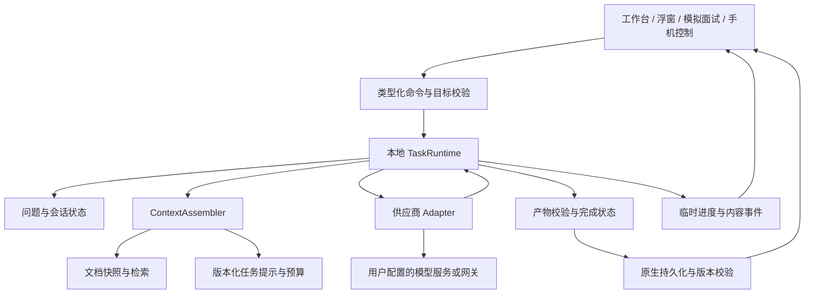

# 本地 BYOK AI 架构方案

设计：`AI-DESIGN-001`，2026-10-30。状态：目标架构；已增量实施基础子集，当前证据见 [实施记录](iterations/2026-10-30-foundation.md)。

本方案承接 [初次审计](../../audit/ai-context-and-prompt-review.md) 与 [官方参考复核](official-reference-review.md)。目标不是复制原版服务端，而是在现有项目内让问题、资料、模型请求和结果都具有明确的合同与来源。

## 1. 目标、约束与不变量

### 1.1 产品目标

- 笔试：题干完整、题目不混、代码接口正确，清楚区分未验证和已运行的结果。
- 实时面试：及时给出可以自然说出口的高质量参考；默认候选人可能照读前文，后续追问自然接续方案，同时在后台区分 AI 建议、实际回答和个人事实。
- 模拟面试：题量与追问可控，提示和复盘围绕同一资料版本与真实训练表现。
- BYOK：用户选择服务、模型和发送范围；兼容性问题不隐藏成无尽重试或未授权的服务切换。
- 迭代：能从一个结果追到其问题修订、提示版本、资料范围和供应商状态。

### 1.2 必须由程序保证的不变量

1. 新修订的问题不会被旧生成尝试覆盖。
2. 候选人实答、AI 建议、截图识别与个人事实陈述不会只因 role 相同而混为一类。
3. 收藏、复制或重播不升级内容的事实确认状态。
4. 检索只在本次授权文档集合及版本中进行；撤销或删除后不得再次发送其正文。
5. 没有执行结果，不显示“已运行通过”；没有统计数据，不显示真实题频概率。
6. 被取消、失去所有权或会话已结束的尝试，不能恢复到当前界面，也不能触发朗读。
7. 供应商能力和客户端采集能力是本地规划输入，不作为任意字段发给模型 API。
8. 未知状态明确保留，不能把 unknown 静默改写成成功或用户事实。

提示词只能补充行为指导，不能替代这些不变量。程序也不能保证用户提供的经历绝对真实；它保证保留来源、用户声明和校验范围，不把声明包装成第三方认证。

## 2. 运行位置与 Module 划分



### 2.1 保留当前会话所有权

实时面试和笔试的运行逻辑继续由其拥有运行时的窗口执行；模拟面试由对应模拟窗口执行。工作台及手机提交受限命令，不在各自页面另起一条相同的 AI 链路。

该选择兼容项目近期的会话生命周期修复，不重新让工作台创建一份独立引擎。拥有窗口重载或被替换时增加 `ownerEpoch`，旧运行时不能继续写入。原生层对持久化操作做版本及所有权检查；仅在 TypeScript 中比较全局变量不够覆盖跨窗口竞争。

手机控制继续只开放有限操作，如请求作答、停止、切换展示和结束。它不获得原始供应商密钥，也不因连接副屏而获得任意原生调用或任意文档读取能力。

### 2.2 小 Interface，集中 Implementation

| Module | 对外 Interface 的责任 | 内部隐藏的复杂度 |
| --- | --- | --- |
| `TaskRuntime` | 执行一个目标明确的任务，发出进度，返回标准结果 | 状态、取消、重试、调用关联、过期写入过滤 |
| `ContextAssembler` | 根据任务与固定版本输入，返回请求材料和来源清单 | 历史选择、题目隔离、预算、引用去重 |
| `KnowledgeAccess` | 在允许的快照中选取背景 / 证据 | 当前内存词法；后续可选索引、向量和重排 |
| `GenerationAdapter` | 标准化请求与结果终态 | 实际角色、字段、鉴权、SSE、供应商限制 |
| 原生记录仓库 | 校验目标版本并原子提交产物 | 备份、迁移、跨窗口冲突与通知 |

这不是要求一次新增五个复杂服务。可先从现有模块抽出纯函数和少数 Interface，避免“每个页面 → 一个新服务 → 原函数”的空透传层。相同协议共用 Adapter；只有真实行为差异才新增 Adapter。

ASR 与 TTS 仍有自己的音频 Interface，不强行塞进仅适合文本生成的统一方法。它们共享任务身份、取消和诊断约定，但保留各自数据格式。

概念调用面示例，非当前可用 API：

```ts
execute(command, { signal, onEvent }): Promise<TaskResult>
```

调用者提交任务、问题目标与用户选择，不负责拼 system prompt、猜结束原因或决定哪些历史能进入请求。这个 Interface 也是主要测试面。

## 3. 数据合同：身份、来源与确认分开

### 3.1 核心关联

```text
Session
 ├─ KnowledgeSnapshot → DocumentVersion → EvidenceExcerpt
 ├─ UtteranceObservation / CandidateResponse
 └─ Question
     ├─ QuestionRevision
     ├─ GenerationAttempt → AnswerSuggestion / ExamSolution
     └─ FollowUp / Assessment
```

先新增少量明确字段，不急于把整个历史系统迁成完整事件溯源。

| 实体 | 关键概念字段 | 必要约束 |
| --- | --- | --- |
| `UtteranceObservation` | id、sessionId、rawText、normalizedText、captureSource、speakerEvidence | 原始观察不被清理或“润色”覆盖 |
| `Question` | id、sessionId、currentRevision、sourceObservationIds、state | 身份稳定；一题可来自多段话 / 多张图 |
| `QuestionRevision` | questionId、revision、正文、约束、截图引用、changeReason | 修订不可原地覆盖；明确指出更正了什么 |
| `GenerationAttempt` | id、questionId、revision、ownerEpoch、policyVersion、状态 | 重试是新 attempt，不是新题或新修订 |
| `CandidateResponse` | id、questionId、正文、输入来源、提示使用记录 | 不等同于任何 AI 生成文本 |
| `AnswerSuggestion` | id、attemptId、内容、完成状态、来源清单 | 展示与收藏不证明用户采用或表达 |
| `MaterialEntry` | id、origin、原始引用、确认记录 | 容器 source 不替代条目 provenance |
| `EvidenceExcerpt` | documentId、documentVersion、范围、sourceKind | ID 与版本稳定，能回到实际来源 |

真实代码中可继续提供旧 `ChatMessage` / `ExamQuestion` 的兼容视图，但新上下文装配不能再只依赖 `INTERVIEWER/ASSISTANT`。

### 3.2 三个正交维度

```text
actor：interviewer / candidate / assistant / unknown
origin：typed / audio_transcript / file_extraction / model_generated / legacy_unknown
assertion：unreviewed / user_asserted / source_checked / disputed
```

`source_checked` 表示该陈述与标明的来源相符，不表示雇佣或项目事实已被外部认证。用户修改 AI 草稿后原始 origin 不消失；可增加人工修订记录。确认应作用于具体陈述或用户明确选中的范围，不能一键把模型整份输出都变为事实。

例如，AI 生成“我将延迟降到 20 ms”后收藏，只记录参考建议。用户实际确认“我负责缓存模块”时，只新增这一项确认，不连带确认 20 ms 数据。

### 3.3 说话人信息也分层

采集来源如系统回采、麦克风，与说话人身份分别保存。`speakerEvidence` 可以是：

- 用户在当前任务中明确指定的说话人；
- 服务商返回的说话人标识，附其协议与质量限制；
- 基于任务 / 采集路径的假设；
- unknown。

模拟面试的“录我的回答”操作可声明预期 actor 为 candidate，但这不是声纹认证。真实面试的麦克风也可能用于向助手追问，不能统一当作候选人实答。系统回采同样可能含其他播放声音，不自动升级为确定面试官。

首期采用任务声明、人工更正和不确定标记；不默认收集声纹。

## 4. 命令与生成状态

### 4.1 规范命令

| 命令 | 作用 | 应如何影响既有结果 |
| --- | --- | --- |
| `CreateQuestion` | 将确认完整的观察 / 图片构成题目 | 生成稳定问题 ID，再请求答案 |
| `CorrectQuestion` | 更正已知目标题目，带 expectedRevision | 新增修订；旧答案保留但标记过时 |
| `MergeQuestions` | 合并同会话中明确指定的题 | 创建规范新问题；记录原 ID 的合并关系，旧任务失效 |
| `WithdrawQuestion` | 撤回一个目标题目 | 停止队列与当前生成，不删除审计关系 |
| `GenerateAnswer` | 对指定修订作答 | 创建新 attempt，不覆盖实答 |
| `RetryGeneration` | 用户或受控策略重新尝试 | 新 attempt，保留旧的部分产物和原因 |
| `SubmitCandidateResponse` | 提交候选人实答 | 触发模拟训练下一步，而非记录为 AI 建议 |
| `StopGeneration` | 停止指定 attempt | 保留已收到内容并标记取消 / 不完整 |

命令至少包含 `commandId`、目标会话 / 题目、预期修订。重复投递同一 commandId 应读取既有本地结果，不重复起一次模型调用；但本地去重不能保证上游网络 exactly-once。

### 4.2 状态与写入围栏

生成尝试可经历：`queued → preparing → requesting → streaming → terminal`。terminal 是生命周期终点，不等于答案正确。

写入最终产物或更新当前结果前，必须检查：

```text
运行身份仍有效
&& ownerEpoch 仍匹配
&& 会话允许当前操作
&& 问题当前修订仍为请求的修订
&& attempt 尚未取消、撤回或被取代
```

流事件携带 `attemptId` 与单调递增序号。UI 忽略旧 attempt 和重复序号；最终快照只校正同一 attempt 的传输内容，不能覆盖另一个修订，也不能凭空恢复未生成的尾部。

token / PCM 事件用于临时展示，不逐 token 保存长期事件日志。重要命令、修订、终态、最终产物和请求清单需要保留；可有限频率做恢复快照。跨窗口的最终提交在原生记录仓库中再次校验。

### 4.3 具体竞态

问题 Q 第 1 版排队后，用户将 Redis 更正为 Redisson，形成第 2 版。第 1 版尝试被取消；其迟到正文丢弃，取消前已经保存的内容可作为旧尝试的过期记录保留，不进入当前上下文、不替换第 2 版答案、不触发 TTS。诊断可记录“忽略迟到事件”的计数，不为追踪而在取消后继续追加正文。

Q2 / Q3 在 Q1 生成期间陆续到达时，Q2 的请求只使用其消息截止位置及明确关联背景，不把 Q3 当成候选人对 Q2 的补充。对“等等，我重新问”先取代或要求选择目标，不机械排成多个待答任务。

## 5. BYOK 能力与结果合同

### 5.1 能力描述保留证据等级

能力记录按连接、模型及已知版本管理；字段可标为 `declared`、`documented`、`observed` 或 `unknown`。记录支持范围与来源，不设置一个模糊的“该模型已验证”总开关。

主要能力包括视觉输入、结构化输出模式、角色支持、上下文限制、输出参数名称和终态语义。对话测试通过只能证明那次请求成功，不能证明视觉、长代码或 JSON Schema 也可用。

修改网关地址、模型、账户相关配置或协议版本时重新评估能力记录。未知时保守限制，允许用户明确配置；探测由显式动作启动并说明可能调用计费，不能每次打开设置就自动付费试遍模型。

**本地能力描述不原样序列化到模型请求。** 适配器只输出该协议支持的 body、headers 和参数。原版的 `canReadScreen` 是其业务后端字段，不是通用模型能力协商标准。

### 5.2 分离三种结论

| 层 | 回答什么 | 例子 |
| --- | --- | --- |
| 传输状态 | 连接和响应体怎样结束 | EOF、断线、取消 |
| 供应商生成终态 | 上游报告为什么结束 | normal / length_limit / refused / interrupted / unknown |
| 任务产物状态 | 结构和本题要求是否满足 | valid / invalid / needs_clarification / unchecked |

另行记录验证证据：未执行、人工核对、运行样例、扩展用例等。正常 stop 与 schema valid 都不证明代码正确或个人经历真实。

供应商没有明确终态时按该 Adapter 的已知合同处理；若仍无法证明，则保留 unknown。兼容接口的有用文本仍可以展示，不把所有未知接口直接判死，也不将其宣称为已验证完成。

概念结果，不是现有类型声明：

```ts
interface TaskResult {
  attemptId: string;
  questionId: string;
  questionRevision: number;
  artifact: unknown;
  providerFinish: 'normal' | 'length_limit' | 'refused' | 'interrupted' | 'unknown';
  taskStatus: 'valid' | 'invalid' | 'needs_clarification' | 'unchecked';
  verificationRefs: string[];
  sourceRefs: string[];
  manifestId: string;
}
```

### 5.3 重试与降级

- 认证、权限和不支持参数错误不循环重试，提供配置处理入口。
- 限流或暂时故障可以有限退避，次数、deadline 与最大调用预算都由 TaskPolicy 限制。
- 收到内容后的异常、取消、上游是否接受不明时，优先保留部分产物并允许用户决定是否新开尝试。
- 重试仍受同一问题修订和会话所有权校验；不能因前一次失败而绕过围栏。
- JSON 结构修复是可选的新调用，最多受控一次并记录成本；不在未知供应商上无限尝试不同字段。
- 不自动切换到另一个未授权供应商或地域。用户明确配置的备用策略也必须遵循其允许的数据范围与费用设置。

超时、重试上限的具体数值在实现时通过任务测试确定，不在设计中宣称一个常数适合全部服务。

## 6. 上下文与资料使用

### 6.0 连续回答优先，来源标记在后台生效

候选人大概率采用或照读 AI 答案。因此前文建议是后续追问的重要上下文：默认沿用架构、术语、约束和已经解释过的理由，不要求每轮确认，不因来源是模型就过滤掉建议。明确的用户纠正、已记录实际回答、原始资料冲突和技术错误触发前提更新。前文没有依据的个人职责、规模和收益不能因重复引用变成已核实经历。

例如前一轮采用 Redis 缓存，下一轮问一致性时应在该方案下展开；用户补充“我刚才说的是本地缓存”后改用实际说法。可选的“补充我的实际回答”用于纠偏，不是生成下一轮答案的必经步骤。详见 [ADR 0004](../../adr/0004-answer-continuity-default.md)。

### 6.1 每个任务有独立上下文策略

| 任务 | 必须保留 | 默认不加入 |
| --- | --- | --- |
| 实时面试参考 | 当前问题修订、必要实答 / 观察、本人相关事实、明确标注的旧建议 | 全岗位进度、全场所有截图答案 |
| 新笔试题 | 当前图片、题干结构、约束、代码接口与语言偏好 | 不相关简历和历史面试 |
| 笔试追问 | 目标题目、最新有效代码、相关报错、必要原图 | 其他题目拼接后截尾 |
| 模拟出题 | 资料快照、训练计划、近期实答、当前主题 | 无限全量 transcript |
| 辅助提示 | 同一问题与资料证据、提示等级 | 直接泄露完整答案作为默认提示 |
| 复盘 | 真实问答、提示使用、评分量表、岗位目标 | 将未覆盖能力推定为低水平 |
| 题库准备 | 明确选中的简历 / JD / 资料版本、经验目标 | 默认第一份简历或未经说明的公司概率 |

`ContextAssembler` 是纯装配逻辑：输入版本固定，输出请求材料、来源清单、预算使用和省略原因。不自行访问任意文件、运行生成代码或开启额外模型调用。

### 6.2 快照固定版本，片段按轮选择

会话快照保存 documentId + version + 授权范围，不只保存开场命中的文本。每轮可以检索该范围内的其他片段。新一轮换了项目仍可获得原文，另一窗口编辑简历不会悄悄重写本场背景。

用户主动刷新资料会产生新的快照版本；资料删除 / 撤销授权优先于旧快照，阻止后续正文发送。已有产物引用保留为“来源已不可用”，不能为了保留可复现性而继续发送被撤销的内容。

用户可以选择明确不使用某份简历，不能把 null 自动当成取第一份样例资料的授权。诊断重放也必须检查资料当前是否仍允许使用。

### 6.3 预算和记忆

首先保留当前题目、纠错和关键约束，再分配必要的个人背景、近期原文和检索证据。总预算同时考虑输出预留、消息模板和图像成本；未知 tokenizer 采用保守估算并标明估计值。

旧历史可转为有来源的结构化状态，如当前主题、已确认前提和未解决问题。摘要不能把模型建议升级为事实，也不能只对摘要反复摘要直至失去原始引用。完整历史继续存档，装配时不要求全部发送。

### 6.4 RAG 的分阶段选择

首期在短简历 + JD 上比较完整必要背景注入与当前词法方案。较长资料先改切块边界、技术短词、指代查询、无命中空返回和重复控制。

词法、向量与重排的选择由相同任务集对照决定，不以是否“像原版”或是否用了向量库为依据。向量 / FTS 索引是可重建派生数据，独立于业务记录；需要时放原生本地存储，不把大向量塞入跨窗口全量业务 JSON。

语义检索新增的文档外发、费用和模型维度必须明确。更换 embedding 模型、chunker 或文档版本时失效旧索引。原始 origin、文档版本及授权过滤贯穿召回和重排；AI 草稿与确认事实不共用默认信任级别。

具体检索比较、中文 FTS 限制与指标沿用 [初次审计第 9、11 节](../../audit/ai-context-and-prompt-review.md)，不重复承诺固定 top-k、收益百分比或模型型号。

## 7. 提示词、预设与指令工作台

### 7.1 先管理现有模板

PromptRegistry 保存模板 ID、不可变版本、任务、输入约束、输出合同、来源及变更说明。渲染结果与 TaskPolicy 一起形成请求清单。

模板职责分为：稳定事实 / 完成合同、任务主体、类型化参数、独立证据数据和当前请求。供应商角色差异由 Adapter 处理；不可信文档不直接成为高优先级指令。

同一模板不同时承担面试官出题、候选人参考作答和最终评分；这些任务共享事实来源而非共享一段万能 prompt。

### 7.2 产品开放顺序

1. 展示当前生效的模板、语言、长短和代码模式，支持恢复默认。
2. 开放风格与任务参数，提供本地请求预览，敏感资料默认折叠 / 脱敏。
3. 开放专家模式的自定义任务主体，明确它不能关闭来源隔离、版本校验和完成状态。
4. 可选 AI assist：用户主动点击，使用选定模型，结果先进入草稿，不自动保存、启用或覆盖默认模板。

“整段接管”若仍保留应用合同，文案应叫“自定义任务指令”，不能假装用户能覆盖一切。若未来确有完全自由的实验模式，应与正式任务和质量承诺分开设计。

历史 `instructionsPrompt` 等字段目前可能未消费，迁移时标为待检查的旧配置，不在更新后突然执行。快捷提示是有目标的任务意图或可编辑文案，不是可执行脚本；模板渲染不使用 `eval` 或任意代码执行。

### 7.3 版本与回滚

内置预设随应用版本管理；用户编辑形成独立修订，保留基于哪个预设版本。更新内置预设不悄悄覆盖用户版本。删除个人自定义内容应可清除其本地正文，历史诊断只保留必要版本标识。

发布前比较旧版与候选 prompt；不要一次变更模型、检索、预算和模板后只说“新版本更强”。每个取舍用评测与迭代记录说明。

## 8. 各任务的具体产品设计

### 8.1 实时面试

界面区分待确认观察、已构成的问题、AI 参考建议和本人实答。先提供可达的纠错、合并、撤回与选择目标；自动语义合并要在人工流程正确之后再评测。

问题调度优先处理当前有效版本，显式展示排队 / 已取代，不为每次停顿都启动生成。用户自述事实可记录为 user_asserted，不因存在一份更旧简历而无条件忽略纠正，也不把无证据的新数字自动认证。

### 8.2 笔试

一次图像任务可识别多个问题，每题有自己的 ID 和截图映射；追问明确选择题目与代码修订。清晰短题可以一次请求完成，缺关键约束或复杂多页关系时再进入提取 / 确认阶段。

模式描述围绕先给结论、解释深度和代码完整性，不以不可测的“秒出”或“指定通过率”承诺。学习用暴力基线和错误案例与正式解法分开，不故意伪造提交通过率。

### 8.3 模拟面试

应用维护新题配额、主题覆盖、连续追问和总轮次 / 时长；模型建议下一题，程序校验其动作是否允许。基础 / 项目比例要么作为诚实的倾向配置，要么用明确配额追踪，不用 51 与 100 实际同一 prompt 却暗示精确控制。

辅助提示按等级记录使用情况；复盘依赖真实回答、提示程度和岗位量表。未听清与未问到分别标识，不将“无证据”打成零分。结构失败进入可恢复状态，不把原始 JSON 或解释直接朗读成问题。

### 8.4 ASR、TTS 与健康提示

热词候选由选中资料生成，可用纯术语提取先行；用户确认后映射到实际 ASR 支持的词表。语音来源不明时提供人工纠正和暂停自动作答，不默认启动声纹服务。

TTS 继续读已保存的当前有效问题。开始录音、问题更正、结束或失去所有权时取消待播；旧文本的缓存不能绕过问题版本检查。声音发音和设备恢复需要实机测试，不能用返回字节作为音质验收。

健康提示采用原版可借鉴的轻量模式：无音频输入、重试次数过多、资料不命中时给可关闭的具体提示，不阻断作答。提醒只表示当前信号，不制造模型“准确率下降”等未测量结论。

### 8.5 题库和外部搜索

题库生成明确使用用户选中的简历与岗位，不默认取第一个记录。输出称为准备方向或 AI 推测；有频次数据时展示样本期、来源、口径及限制，不拿频次推导录用概率。

搜索是独立的可选 Adapter 与权限范围。没有执行真实搜索时，不显示“已联网”或伪造来源。公司资料、网页和返回片段都是外部数据，不能覆盖应用指令；用户个人简历不能无意拼成外部搜索关键词。

## 9. 持久化与迁移

初期复用现有原生数据仓库与备份策略，新增 schemaVersion 和可向后读取的映射，不为了本次 AI 设计立即更换全量存储。原生提交需要预期版本与拥有者校验；窗口事件仅通知状态变化，不承担最终一致性证明。

迁移建议：

1. 读取旧数据并生成迁移预览 / 统计，不修改原文件。
2. 根据明确的会话类型转换可确认的角色；不确定内容保留 legacy_unknown。
3. 旧同一 turn 有多题但缺精确分界时，保留为 legacy composite，不用模型偷偷拆题和重写原图关联。
4. 对旧收藏条目保留其容器来源提示，不猜测每个条目都人工原创或模型原创。
5. 写入前备份，候选数据校验后原子替换；按 schemaVersion 幂等执行。
6. 校验记录数、引用、原图、时间与正文保留情况，失败可恢复。

迁移不默认调用云模型。降级到旧应用版本时是否能安全写入需另行验证；不承诺“保留旧字段就天然支持双向无损降级”。

索引、检索缓存与音频缓存有自己的失效合同，不与业务记录迁移混为一谈。资料撤销、删除和备份保留期也需覆盖派生副本。

## 10. 诊断、重放与验收

请求清单记录任务、题目修订、模板 / 策略版本、模型和连接 ID、资料版本 / 片段 ID、预算估计、用量、首个有用输出时间、终态与重试次数。密钥、完整正文和完整提示默认不进日志。

保存清单不等于能逐 token 确定性重放；供应商别名、模型变动和随机输出都会影响结果。无授权或已删除原文时不能擅自恢复材料。诊断导出需脱敏并由用户主动选择范围。

验证分四层：

- **本地确定性合同测试**：关联、修订、授权、装配、解析、重试与迁移。
- **供应商协议夹具测试**：分段 SSE、终态、错误及参数映射；使用合成输入，不计费。
- **端到端交互测试**：纠错、排队、切窗、手机控制、取消和 TTS，不使用私人状态。
- **真实质量评测**：经预算授权的模型调用、留出样本、人工校准与设备测试。

代码覆盖率不换算成答案正确率；协议测试通过不换算成模型能力通过。设计状态与实施 / 验收状态在 [实施路线](implementation-plan.md) 分开记录。

## 11. 实施方式

先让一个真实任务走通新合同，例如“笔试问题修订 → 请求 → 完成状态 → 产物”，再将实时面试和模拟面试接到同一套来源与状态规则。保留已有 BYOK 配置、语音能力和用户历史的读取路径，逐步替换重复拼接。

不要同时重写 UI、数据存储、检索和所有供应商。每次迭代明确其对应审计项、失败复现、变化范围、结果和未解决问题；遇到不能兼容的协议时显式说明，而不是扩大自动修复链。

本方案预计可改善可追溯性、事实归属和错误恢复，但**实际回答质量、延迟与费用收益仍需验证**，不因设计更透明就宣称已经超过原版。
